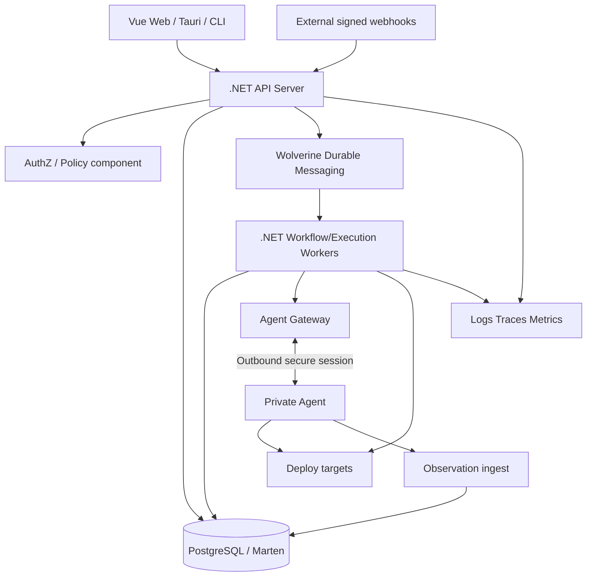

# C4 Container / Process topology

**C4 container không đồng nghĩa K8s container:** là deployable app/data store. Ban đầu API + Workers có thể dùng chung modular monolith source nhưng chạy khác process. Agent là tiến trình độc lập để nối mạng riêng.

### Runtime boundaries
- API không giữ long-running deploy request đồng bộ.
- Worker chịu trách nhiệm durable scheduling; không lưu state chỉ trong RAM.
- Gateway không chứa quyền quyết định approval; chỉ xác thực và chuyển operation có chứng thực.
- PostgreSQL giữ operational state; log blobs/object store nếu cần; không đẩy raw log vào event store.
- Broker bên ngoài (RabbitMQ) optional trong MVP; consumer topology phải tồn tại ở mức hợp đồng.

### Dependency direction
UI → API; handler → application/domain ports; adapters → port interfaces; domain không tham chiếu Helm, Tauri, Wolverine, Kubernetes SDK.
