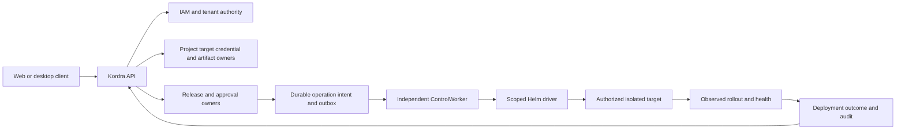

# Control Plane delivery design — Foundation to usable deployment control

## Decision and evidence boundary

The maintainer approved the overall delivery direction on 2026-10-20. On the same date, the maintainer separately accepted ADR-0012, local-authentication-v1, authority-admission-v1 and Foundation T01–T07 for implementation. The adopted first slice covers local identity, owner-specific persistence, session handling, tenant/project/target ownership and the single-process admission/audit protocol. It does not accept the broad ADR-0009 architecture, release/execution-v1, messaging/Agent/provider implementations, production access or the full OSS architecture. ADR-0001/0002/0004/0005/0006/0009 remain proposed.

This document owns **cross-feature composition and milestone acceptance**, not copies of owner business rules. [Roadmap](../product/roadmap.md) remains the progress source, owner features remain behavioral sources, and the [Luna handoff](../engineering/luna-implementation-handoff.md) is the dependency-ordered implementation guide. No second GOAL service or checkpoint system is introduced.

Inspected source base: `63a7951f48b4441e880defaf315c3755ff79842b` plus the existing uncommitted IAM I2.7 documentation. Current product code is Artifact digest validation and the denied-ingress local Inventory bootstrap. IAM proof code is test-only; most reserved module/host folders contain README files. No code capability is inferred from this design.

## Product outcome and logical composition

An independently installed sandbox must support: local identity → tenant/project/application/environment/target → authorized connection → immutable artifact → frozen release → scoped approval → durable dispatch → driver execution → independent verification → audited history → separately authorized rollback.

Arrows are logical calls/data flow, **not source ProjectReferences**. Contract assemblies and host composition break dependency cycles in current module summaries. A module accesses another owner's data through an owner port, never through its tables, ORM context or aggregate. Audit append is a technical producer port implemented by AUD; AUD does not synchronously call IAM to append. Audit queries are authorized by the calling use case. Membership writes consume IAM identity/definition contracts; IAM's use-case composition consumes TEN facts without runtime-assembly cycles.

## Milestones mapped to the existing roadmap

| Milestone / existing task | Product acceptance | Included features | Exit and next dependency |
|---|---|---|---|
| Foundation / F0-C, first M1-A | Real local login, persisted identities and audit, deterministic session invalidation | FEAT-IAM-002, FEAT-AUD-001 foundation | Login/me/logout/password recovery tests, isolated PostgreSQL migrations, same-origin transport and no tenant authority from login |
| Management foundation / M1-A | Create/select tenant, project/application/environment and registered target; assign exact scoped grants | FEAT-TEN-001, FEAT-PRJ-001, FEAT-INV-001 registration, FEAT-IAM-001 enforcement | Cross-tenant/grantor-ceiling/revoke tests and coherent owner facts; target registration alone grants no provider access |
| OP-P0 | Authorized read-only inventory with useful bounded status and freshness | FEAT-SEC-001, FEAT-INV-001 reads, FEAT-OBS-001 read observations | Fake adapter conformance first; separately authorized real Kubernetes/Helm target; identity, TLS, field allowlist and redaction verified |
| M1-B / M1-C | Artifact registration, immutable release and approval queue | FEAT-ART-001 registration, FEAT-REL-001, FEAT-APR-001 | Changed spec invalidates approval; signed intake only when FEAT-CI-001 is adopted; manual authorized registration can precede CI integration |
| M2-A / M2-B, OP-P1 | Sandbox deploy → actual verify → history → guarded rollback; survives Mac closure | FEAT-MSG-001, FEAT-WFL-001, FEAT-DEP-001, FEAT-DRV-001, FEAT-OBS-001 | Independently hosted worker, durable recovery, duplicate/lease/unknown-outcome drills and human-authorized target |
| M3 / OP-P2–P4 | Broader signals, CI intake, controlled backup/restore and adjustments as separate approved features | REC/CI/NOT/SCH; future backup/capacity owner feature decisions | Explicit ownership and operation contracts first; catalog inclusion is not an implementation instruction |
| OSS Beta / M4 hardening | Reproducible install, upgrade, recovery, support matrix and operator documentation | Existing Beta gates and applicable owner features | Second clean environment, migration/restore drills, resource/load evidence, license/publication decisions; Beta is distinct from production-ready |

OP-01–OP-10 remain requirements in [Operator Workstation](../product/operator-workstation.md). No requirement is silently dropped: profile/status/version feed OP-P0; queue/workflow/deploy feed OP-P1; backup, capacity and expanded automation retain their staged owner decisions. The 43-group technology reference remains nonbinding. Production, Enterprise and Cloud need later evidence and authorization.

## Runtime and persistence proposal

For the first M1-A/OP-P0 implementation, accepted ADR-0012 selects one Mac-local API process and one PostgreSQL database with owner-specific tables. ASP.NET Core Identity plus EF Core/Npgsql applies only to identity and the first authorization/catalog/audit records. This scoped choice does not accept all proposed Marten/Wolverine architecture or require replacing it. Later business persistence and durable messaging need explicit compatibility decisions. Never put EF/Marten types in owner Contracts.

Keep the root `Kordra.slnx` and existing source paths. Add owner runtime/Contracts projects only when a handoff task needs them. A narrow admission coordinator supplies process-local ordering; owner ports still evaluate facts. Full multi-replica authorization, independent authority writers and Agent enrollment are outside this first protocol and must not be enabled by a configuration toggle.

For OP-P1, API accepts/persists intent and returns status; an independently hosted ControlWorker performs durable work. The Mac is never the sole host of workflows advertised as surviving Mac closure. Agent is optional until target connectivity/trust requires it. No Agent may depend on Control Plane persistence or domain assemblies. First driver is Helm on an isolated approved Kubernetes target; Compose follows only after the first driver proves contract/recovery parity.

## Cross-feature contracts and security boundaries

| Seam | Owner → consumer | Contract authority / next action |
|---|---|---|
| Account/session | IAM → ingress/enforcer | [Accepted local authentication v1](../contracts/local-authentication-v1.md); login provides identity only |
| Tenant, grant, catalog facts and U/D audit ordering | TEN/IAM/PRJ/INV/AUD → protected use case | [Accepted authority/admission v1](../contracts/authority-admission-v1.md); preserves I2.7 behavior and defines a bounded single-process mechanism |
| Browser/client protocol | API owners → independently developed clients | [Client API handoff](../contracts/client-api-handoff-v1.md); Product publishes schemas and examples, never edits/builds the clients repository |
| Artifact identity | ART → REL | Existing [digest contract](../contracts/artifact-identity.md); registry registration adds tenant provenance without changing I1 semantics |
| Release/approval/operation | REL/APR → WFL/DEP | [Release and execution v1 proposal](../contracts/release-execution-v1.md); frozen hash and approval never authorize merge or production access |
| Driver/agent | DEP/WFL → DRV/AGT | Existing [driver](../contracts/driver-contract.md) and [agent](../contracts/agent-protocol.md) proposals; adoption waits owner state/protocol validation |

Existing permission keys are used at their catalog scopes. New capabilities, especially workflow authoring, backups and capacity mutation, require an explicit catalog/owner decision. Human maintainer approval remains required for sensitive production operations; UI approval of a sandbox run is not company authorization. Unknown results are never rendered successful. No data-plane/business queue is used as Kordra's operations queue.

## Reliability and growth boundaries

- Stable logical operation IDs, immutable intent hashes, transactional outbox/inbox and persisted transitions are required before external mutations. Provider effects are not exactly-once just because message delivery is deduplicated.
- Target leases use persisted monotonically increasing epochs; every driver dispatch/receipt is bound to target, operation, intent and epoch. Unknown outcome stops automatic execute/rollback and starts observation/reconciliation.
- One desired-state writer owns each managed target. Existing GitOps/controller ownership is preflighted; coexistence never means two uncontrolled writers.
- Local authorization gate latency and audit cost must be measured before increasing load. Horizontal API/authority scaling requires a replacement proven ordering protocol and explicit migration; the local gate is not distributed fencing.
- Versioned public APIs/messages, additive compatibility, consumer inventory and migration fixtures are deliverables. Export/page/push channels need their own disclosure authorization.
- Package inventories, key rotation, configuration, backups, migration rollback and resource limits accompany an installable release. Infrastructure HA, worker redundancy and production SLOs require actual failure/load evidence.

## Acceptance evidence and handoff

At each milestone record exact source SHA, feature source/test mapping, deterministic gate results and any provider review on its reviewed SHA. Planned acceptance matrices are not passing tests. Existing 133 product tests include the 66-case IAM proof within the 85 bootstrap cases; do not count them twice or claim they prove runtime IAM.

The strategic direction and the exact Foundation T01–T07 design are approved. T01–T07 are ready for Luna implementation after native model/effort verification and AMR checkpoint reconciliation. Later milestones retain their stated ADR/contract gates. Do not reopen unchanged I2.7 approval, erase old checkpoint receipts, auto-launch Sol, trigger PR review from this Architect turn, or merge automatically.
