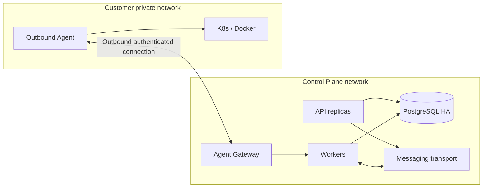

# Deployment topology & environments

## Environments
`local`: single PostgreSQL, API, worker, optional RabbitMQ (only when needed), fake agents/targets; `staging`: realistic auth/policy/agent; `production`: HA/backups/secrets/alerts/least privilege.

## Security network
Internet exposed API only behind TLS/reverse proxy; agent gateway separate auth; DB/broker restricted private network; operator access via identity provider; secret provider isolated.

## Scaling axes
Scale API on request rate; worker pools by target queue/throughput; agent pools per private network; broker partitions/queues by workload type. Never horizontally scale state machine without CAS/fencing and leader/lease plan.

## Unresolved
`[NEEDS-DECISION]` production cluster/VM host, multi-region requirements, tenant isolation tier, HA/RPO/RTO, identity provider. Không kết luận dựa trên diagram.
