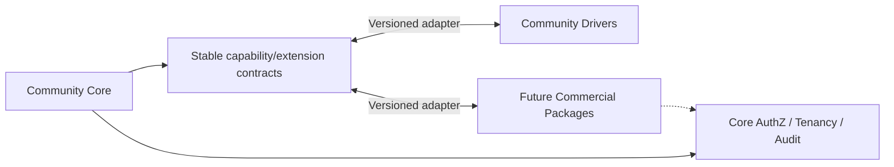

# Kordra — OSS Extensions & Future Commercial Readiness

> **Status: proposed.** Đây là target architecture, không chứng minh các project/file đã tồn tại. Chỉ trở thành baseline sau khi ADR-0009 được phê duyệt; source thực tế, test và Git commit phải được đối chiếu trước khi đánh dấu implemented/verified.

## 1. OSS-first principle
Kordra Community must be independently usable for safe deployment workflows. Commercialization is a **product option**, not MVP acceptance criterion. Core security, resource authorization, safe rollback semantics and audit primitives must not depend on payment or proprietary extensions.

## 2. Extension seams
| Seam | Candidate contract | Core remains owner of |
|---|---|---|
| Deployment drivers | `IDeploymentDriver`/capability descriptor | approval, immutable spec, lease, result verification |
| CI providers | signed webhook/provider adapter | release identity, artifact digest, governance |
| Secret providers | secret reference resolver | authorization and minimal secret access |
| Observability | target metrics/log integrations | health semantics, audit trail |
| Enterprise policy | policy contributor/enterprise rules | deny-by-default baseline and scope enforcement |
| Auth providers | OIDC/enterprise identity adapter | trusted principal, resource scoping and authorization checks |

## 3. Boundary design

- Extensions receive only scoped, typed capabilities. They must **not** gain direct arbitrary database access, unrestricted cluster-admin, or bypass approval.
- Extension metadata: ID, semantic version, compatible API range, declared capabilities, permissions, required configuration, migration/rollback policy.
- Dynamic plugin loading is **not** a requirement now; built-in compile-time drivers are sufficient until there is actual demand and trusted isolation design.

## 4. Edition separation (proposal)
- OSS monorepo holds core + community drivers + public contracts and docs.
- Proprietary enterprise extensions, if any, live in separate private repository/package and depend only on *stable public extension contracts*.
- SaaS deployment is a separate hosting/operations strategy, not a fork of domain rules.
- Entitlements may enable advanced capabilities but must not disable security invariants or change what an approved deployment means.

## 5. Security/compatibility for extension authors
- Declare required resources, secret scopes, network egress and supported command types.
- Agent driver operation includes immutable spec/operation ID, trusted target identity, deadline, allowed capabilities, result observation.
- Provide contract test suite for Plan/Execute/Observe/Rollback; unsupported capability must fail predictably.
- Core and driver versions must negotiate or reject incompatible calls; no silent fallback to privileged shell.

## 6. OSS governance decisions pending
- LICENSE choice, code provenance, contributor IP attestations (DCO/CLA), dependency notices, trademark and enterprise IP separation require explicit owner/legal review.
- Prior code and LAB-01 integrations may be subject to company rights and confidentiality: **do not publish without authorization**.
- No billing/subscription infrastructure until customer evidence validates demand; record as separate product RFC.

## 7. Acceptance
- A Community install functions with no enterprise package; a sample driver can integrate without importing domain internals; extension denial leaves core safe; upgrade to commercial package does not rewrite stored deployment events.

**See also:** [Driver contract](../contracts/driver-contract.md), [Security/tenancy](security-multitenancy.md), [Repository](repository-structure.md), [ADR-0009](../decisions/0009-source-architecture.md).
