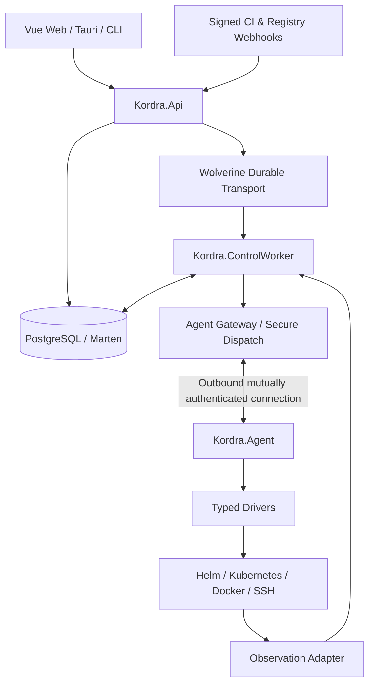

# Kordra — Host Composition & Runtime Topology

> **Status: proposed.** Đây là target architecture, không chứng minh các project/file đã tồn tại. Chỉ trở thành baseline sau khi ADR-0009 được phê duyệt; source thực tế, test và Git commit phải được đối chiếu trước khi đánh dấu implemented/verified.

## 1. Execution hosts and composition responsibilities
| Host | Owns at runtime | Must not do |
|---|---|---|
| `Kordra.Api` | HTTP ingress, auth, webhooks, endpoint hosting, validated command acceptance | wait synchronously for deploy, execute privileged driver commands |
| `Kordra.ControlWorker` | durable queue consumers, long-running workflows, scheduling, reconcile and observation coordination | impersonate user without verified authorization context |
| `Kordra.Agent` | outbound identity, typed operation execution, driver calls, local journal, heartbeat | decide approval/tenant policy or access Control Plane DB |
| `Kordra.DbMigrator` | guarded schema migrations/bootstrap | auto-migrate all production DBs on every API startup |
| `Kordra.AppHost` | local resource orchestration for development/tests | act as production HA/recovery controller |

## 2. Example runtime topology

- Logical topology: Gateway có thể cùng process với API/Worker giai đoạn đầu; tách network deployment khi tải/bảo mật đòi hỏi.
- API command returns an accepted operation ID after durable persistence; ACK từ agent khác verified deployment outcome.
- Agent reconnect và `Unknown` outcome phải reconcile trước retry; lệnh có operation ID/fencing, không blind repeat.

## 3. Composition root
- Đăng ký modules thông qua extension `Add<Module>(...)` hoặc convention explicit được kiểm soát; host không trực tiếp tạo aggregates.
- Endpoint modules chỉ được mount trong API; worker-only consumers/scheduler chỉ chạy trong Worker; shared library ≠ shared execution.
- `Host` là nơi khai báo feature flags/driver registration, OpenTelemetry, secrets providers, health/readiness, transport endpoints.
- Không để các modules tự resolve arbitrary service từ global service locator.
- Startup validation phải fail fast nếu critical configuration/secretRef invalid; không log giá trị secret.

## 4. Environment configs
`Development`, `Test`, `Sandbox`, `Production` là môi trường của **Kordra installation**; `tenant environment` là đối tượng nghiệp vụ được quản lý, không đồng nhất với `ASPNETCORE_ENVIRONMENT`.
- Local: Aspire may start Postgres, API, worker, agent mock, synthetic registry. Không cần Docker Compose vừa khởi động qua Aspire vừa bind port trùng.
- Sandbox: isolated target with least privilege; driver conformance tests.
- Production: explicit readiness/liveness, graceful shutdown, durable storage, secret rotation, network policy, controlled DB migrations.

## 5. Message separation and authority
- Internal Kordra durable delivery (Wolverine is a proposed adapter) is a separate responsibility from observing customer-owned brokers such as RabbitMQ/VerneMQ.
- MOD-MSG owns internal envelopes, routing, inbox/outbox and dead-letter delivery. `[NEEDS-DECISION]` The owner and scope for external broker inventory/observability are unresolved; do not assign them to MOD-MSG or hard-code LAB-01 topology in a generic module.
- Trust boundaries require scoped signed claims and replay controls at Agent Gateway. Secret material stays in scoped secure stores, never carried in telemetry or handoff.

## 6. Liveness and recovery invariants
| Failure | Expected behavior |
|---|---|
| API restart | accepted requests survive via persisted workflow/outbox |
| Worker crash | restart/resume from workflow state; respect target lease |
| Agent disconnect | outcome `Unknown` until observed/reconciled; no blind retry |
| DB unavailable | reject or suspend unsafe mutations rather than claim success |
| Result duplicated | dedup by operation/sequence; preserves one logical outcome |
| Probes unavailable | health remains unknown, not assumed healthy |

## 7. Test & rollout
- Unit test for host registration visibility; integration tests for API→transport→Worker state transition; agent conformance/recovery in isolated harness.
- No cluster destructive test on LAB-01 by default; use fake drivers/sandbox.
- Version compatibility gates on API↔Agent, message schema; staged rollouts should keep old/new worker-compatible message contracts.

**See also:** [Container topology](container-topology.md), [Execution plane](execution-plane.md), [Solution architecture](solution-architecture.md), [Security](security-multitenancy.md).
