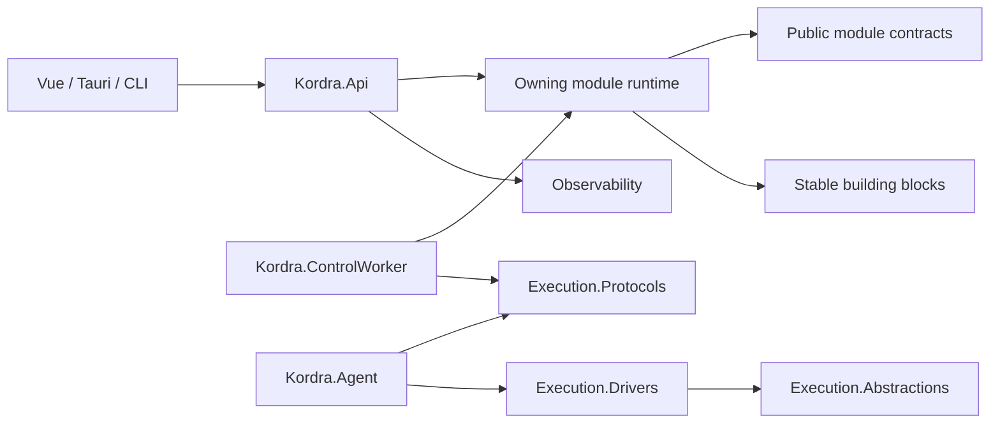

# Kordra — .NET Solution & Project Architecture

> **Status: proposed.** Đây là target architecture, không chứng minh các project/file đã tồn tại. Chỉ trở thành baseline sau khi ADR-0009 được phê duyệt; source thực tế, test và Git commit phải được đối chiếu trước khi đánh dấu implemented/verified.

## 1. Architectural style

2026-10-20 proposal reconciliation: [ADR-0012](../decisions/0012-operator-pilot-runtime-foundation.md) accepts EF Core/Npgsql only for the first local identity/authorization/catalog/audit foundation, with explicit alternatives to custom Identity stores. The broader Marten/Wolverine direction below remains proposed; neither stack is adopted by importing this document. The scoped acceptance does not adopt the broader persistence proposal; never combine persistence engines without a justified decision.

- **Modular Monolith + Vertical Features + DDD where domain complexity warrants it + CQRS where justified**.
- Modular Monolith nói về *ownership/dependency*; API, ControlWorker và Agent được phép là executable processes khác nhau.
- ADR-0009 **proposes** Marten + PostgreSQL for owned documents/events/projections and Wolverine for message handling/durable workflows when justified; these packages and their runtime configuration are not adopted in the current bootstrap. RabbitMQ is only a candidate external transport when required.
- Giữ `Kordra.Api` và `Kordra.ControlWorker` tách runtime concerns; business components của module có thể được load ở cả hai host, nhưng chỉ handler thích hợp được bật từng host.

## 2. Solution layout và dependency graph
```text
Kordra.slnx
  BuildingBlocks/{Core,Persistence,Messaging,Security,Observability}
  Modules/<Module>/Kordra.Modules.<Module>
  Modules/<Module>/Kordra.Modules.<Module>.Contracts
  Execution/{Abstractions,Protocols,Drivers/*}
  Host/{Kordra.Api,Kordra.ControlWorker,Kordra.Agent,Kordra.DbMigrator,Kordra.AppHost}
  Tests/{Unit,Integration,Architecture,Contract,EndToEnd}
```

**Lưu ý:** mũi tên trên là phụ thuộc minh họa; không được tự tạo module reference tùy tiện. Đồ thị chuẩn ở [dependency rules](dependency-rules.md).

## 3. Chức năng project
| Project/category | Runtime | Phụ thuộc cho phép | Trách nhiệm |
|---|---|---|---|
| `BuildingBlocks.Core` | library | BCL + contracts thật cần thiết | primitives không chứa business rules |
| `BuildingBlocks.Persistence` | library | Marten/PostgreSQL | setup & conventions; module sở hữu persistence schema |
| `BuildingBlocks.Messaging` | library | Wolverine, envelope helpers | delivery adapter; không sở hữu event business |
| `<Module>` | library | own contracts, technical ports | feature handlers, domain, owned persistence |
| `<Module>.Contracts` | library | primitive contracts | typed public commands/events/queries/DTOs khi cần |
| `Execution.Abstractions` | library | small core contracts | typed driver operations/capabilities |
| `Execution.Protocols` | library | wire-safe DTO/schema | gateway–agent contracts, version/identity |
| `Execution.Drivers.*` | library/plugin | driver ports + provider SDK | adapter cho Helm, Compose, Kubernetes, SSH |
| `Kordra.Api` | executable | selected module runtime + endpoints | ingress, auth pipeline, DI composition |
| `Kordra.ControlWorker` | executable | selected module runtime, transport | workflows, schedulers, reconciliation/dispatch |
| `Kordra.Agent` | executable | protocol + driver ports/impl | execution worker near target; never require core DB |
| `Kordra.DbMigrator` | tool | registered migrations | schema migration có logging/guardrails |
| `Kordra.AppHost` | dev-only | Aspire resources | local development/test orchestration, not prod dependencies |

## 4. Data ownership & transactional boundaries
- Ban đầu **một PostgreSQL** cho operational data có thể hợp lý; module sở hữu collection/schema/stream và access API. Không tự cho module A query trực tiếp bảng hoặc stream của B để quyết định quyền.
- Inline vs async projection phải chọn theo consistency requirements; authorization/deployment critical state không được dựa độc lập vào eventual projection.
- Thay đổi state + outgoing message phải dùng transactional outbox nơi hỗ trợ; idempotency cho side effects; inbox không đồng nghĩa exactly-once external deployment.
- Không ép Event Sourcing cho mọi entity. CRUD config, approvals, release workflows sử dụng persistence thích hợp theo domain invariants và accepted ADR.

## 5. API, module composition, contracts
- Endpoint có thể co-locate trong feature slice nhưng expose qua `Kordra.Api` host registration; API chứa cross-cutting middleware, không chứa nghiệp vụ.
- Không cho clients truyền `tenantId` tùy ý quyết định scope; principal/resource grant phải validate server-side.
- Background handlers không dùng bypass auth; service principal/operation authorization bảo toàn target/scope và approval.
- Public contract (REST, message, agent) có version policy, compatibility tests; change cần kiểm consumer trước merge.

## 6. Solution build & incremental creation
1. Khởi tạo minimal `src/Kordra.slnx`, build props, base host, 1 vertical slice, 1 test project.
2. Thêm Postgres/Marten và Wolverine khi feature cần thật, không chỉ vì scaffold đẹp.
3. Bổ sung ControlWorker khi có durable orchestration đầu tiên, Agent khi có protocol/driver first implementation.
4. Thêm module trong solution + registry + boundary tests + doc feature mapping cùng PR.
5. Không tạo hàng chục `.csproj` trống, không tự microservices hóa.

## 7. Evidence / acceptance
- Solution builds; dependency tests pass; assembly ownership được truy vết; Agent build/run không kéo theo domain runtime hoặc DB; các integration test sử dụng synthetic/isolated infrastructure.
- Chưa xem là `accepted` khi chưa có ADR duyệt và PoC smoke test tối thiểu.

**See also:** [Repository](repository-structure.md), [Module structure](module-internal-structure.md), [Host](host-composition.md), [Messaging](messaging.md), [ADR-0001](../decisions/0001-modular-monolith.md).
