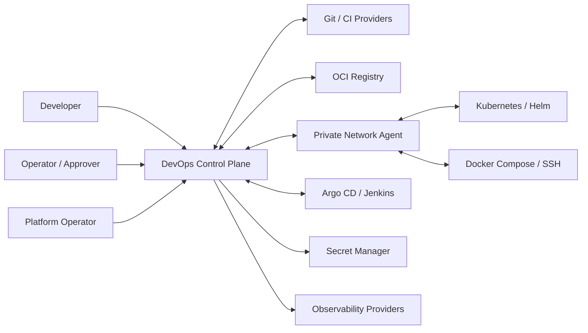

# System Context — Actors & external systems

**Control Plane owns:** release intent, frozen deployment specification, authorizations, workflow, audit, agent routing, inventory metadata.

**Does not own:** CI source build result, OCI blob durability, Kubernetes desired manifests when GitOps owner, cloud infrastructure provisioning (unless future plugin ADR).

### Trust boundaries
Browser/Desktop ↔ Public API; external webhooks ↔ Ingress; API/Workers ↔ broker/DB; Control Plane ↔ Agent Gateway; Agent ↔ target infrastructure. Mỗi boundary cần authentication, authorization, anti-replay, timeout và correlation.
