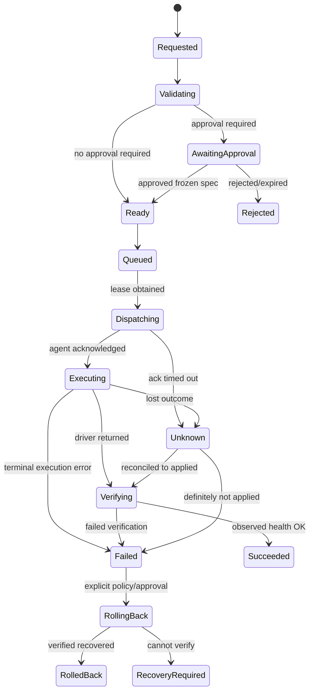

# Durable workflow, state machine and approvals

## Separation
- **Release Manager/Policy:** resolves allowed release and frozen spec.
- **Workflow Orchestrator:** owns process state, durable timers, transitions/compensations.
- **Deployment Coordinator:** acquires per-target lease, dispatches exact operation.
- **Worker/Agent:** executes and reports; cannot independently approve.
- **Observer/Reconciler:** verifies real state; `accepted`/`sent` ≠ `succeeded`.

## Deployment state machine

## Invariants
- Once approved: `artifactDigest`, deployment spec hash, environment, target, approver, policy version locked; any material change restarts approval.
- Require monotonic persisted transition with optimistic concurrency; terminal states cannot transition arbitrarily.
- Every external execution has stable `operationId` and one lease/fencing epoch; retry must inspect target/operation journal before applying.
- Timeout is not equivalent to failure; `Unknown` needs observation/manual resolution.
- Rollback cannot guarantee DB state restoration; external migrations require separate plan.

## Crash recovery
Persist next action before side effects; on restart claim orphan work with lease; query operation journal/target; reconcile before repeat; resume timers. No workflow truth only in RAM.

## Approval SoD
Requester cannot self-approve protected environments by default. Policy may specify one/two approvers, TTL, change window, step-up auth, explicit emergency override with audit. Do not hardcode production by environment display name; use environment classification/policy.
